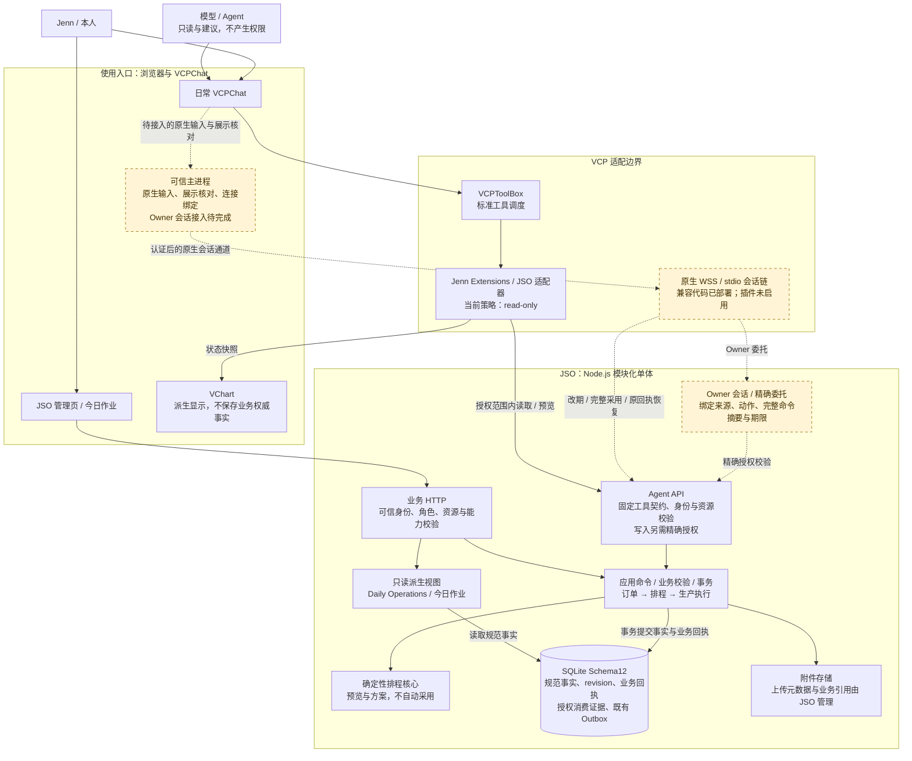
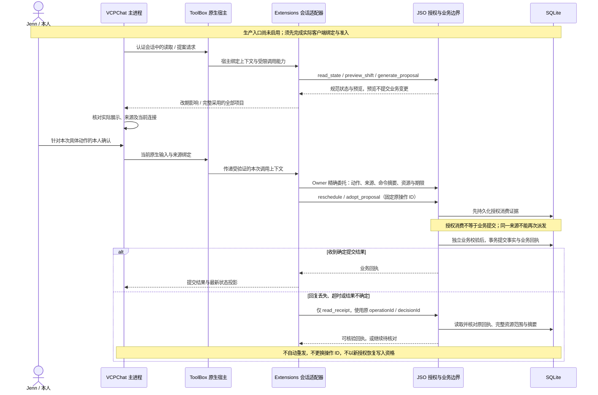

# JSO 当前系统架构与启用边界

更新日期：**2026-10-30（Asia/Shanghai）**。这是当前实现及启用状态的说明图，不新增架构决定、权限或生产启用授权；历史冻结基线仍由[架构基线索引](ARCHITECTURE_BASELINE_INDEX_V2.1.md)管理。

当前阶段：**独立应用已上线；VCP 改期与完整方案采用的兼容代码已部署；真实日常客户端接入与业务验收未完成。**

## 1. 组件与数据权威

箭头表示调用或依赖。实线为当前可用的应用/只读调用及内部实现关系；虚线为已实现、尚未启用并完成实机验收的原生业务链。图按逻辑边界组织，不表示服务器数量或物理位置。

- **JSO 是业务事实的权威。** 订单、场次、任务绑定、生产事件及业务回执保存于 SQLite；VCPChat、VChart、模型输出和备份都不是第二套可独立写入的业务库。
- **JSO 保持模块化单体。** 图内的 HTTP、授权、排程、投影和事务是职责边界，不是需要分别部署的微服务。三种 revision 分别约束排程、单场执行和派生投影。
- **浏览器现有业务权限与原生接入分开。** “原生写入未启用”不表示 JSO 管理页全部只读；管理页继续走既有认证、预览、确认和回执语义。
- **标准模型工具入口保持只读。** 生成方案属于建议；模型、提示词、`approved=true` 或工具参数均不能产生 Owner 身份或写入授权。
- **附件字节与数据库需一起恢复。** 数据库保存上传元数据和业务引用，备份校验同时检查附件完整性。

## 2. 原生改期 / 完整采用的执行与恢复设计

以下绘制已实现并通过隔离测试的“先预览展示、再本人确认”路径，**不是当前生产原生写入已经开启的证明**。既有精确原生改期指令的直办分支未在此展开，仍受真实来源、会话及精确授权校验约束，不改变本轮逐次业务写入确认要求。本轮仅覆盖改期与完整采用；部分采用、批量操作及其他业务写入不在本轮原生验收范围内。

具体边界：

- Owner 与执行者均须覆盖目标资源；Owner 会话、Agent 身份与宿主凭据分离，凭据不进入模型或插件参数。宿主给子进程的是短期受限调用能力。
- 改期与完整采用使用各自的业务标准化和校验。完整采用必须展示全部项目，并通过操作者核实的 synthetic/non-customer 订单白名单；预览混入白名单外项目时拒绝整个方案，不裁剪后冒充完整采用。
- 方案展示、来源或连接变化后，旧确认资格失效；实际提交仍受权限、期限、当前 revision、业务约束和事务内执行检查约束。
- 直接提交响应与回执查询分开校验。采用恢复必须有 `kind=proposalDecision`、原 `decisionId`、匹配的完整 `resourceScope` 及决定摘要；缺失则保持待核对。改期继续使用原 `operationId` 和独立的资源校验。
- 业务库中的授权消费证据是防止重复派发的持久记录；VCP journal 保存来源、操作标识和待核对状态。journal 不是业务事实权威，也不会把重启前的确认资格恢复为新授权。

## 3. 当前状态与证据边界

本次 **2026-10-30** 只读复核确认：生产 JSO 镜像与 #96 部署记录相符、容器运行；ToolBox 服务 active，broker 与部署记录匹配；受保护配置及源文件摘要一致；原生插件仍未启用，`vcp_chat.c2` 仍为 `PRODUCTION_DISABLED`。

| 层次 | 已具备 / 已部署 | 尚未完成或不能据此推断 |
|---|---|---|
| JSO 独立应用 | Schema12 / V3 订单、排程、生产执行、附件与今日作业；生产兼容更新已应用 | Studio Day 的当前日常客户端完整验收仍由 #89 收尾 |
| 标准 VCP 工具 | 授权范围内读取、预览及原改期回执探测通过；适配策略保持 `read-only` | 模型工具调用不获得写权限 |
| 原生改期 / 完整采用 | #96 / 扩展 #32 / ToolBox #300 的兼容代码已合并部署；针对性与跨仓库隔离测试通过 | 实际客户端 Owner 会话绑定、生产准入与拒绝测试、两类逐次确认业务写入及回执核对 |
| VCPChat / VChart | 现有通用原生展示、输入捕获、连接失效及状态投影实现 | 客户端源码或 UUID 的存在不证明当前本人会话已接入 |
| Kiosk / 现场与通知 | 既有代码能力与独立授权边界；Outbox 属于业务数据 | 本图未重新验收 Kiosk 启用状态，也不表示真实外部通知已开启 |
| 备份 / 回滚 | 部署备份及恢复副本核验；最新业务库与 VCP journal 的隔离恢复测试 | 实际版本两端协同回滚的最终验收仍待完成；不得用旧快照覆盖后续新写入 |

部署对应代码：

| 仓库 | 合并提交 | 更新内容 |
|---|---|---|
| JSO | [`f39be58`](https://github.com/JENN2046/jenn-shooting-operations/pull/96) | 动作绑定的 Owner 委托、完整采用和 scoped 回执 |
| Jenn Extensions | [`9f99d81`](https://github.com/JENN2046/VCPToolBox-JENN-Extensions/pull/32) | 原生完整采用、白名单、展示与未知结果恢复 |
| VCPToolBox | [`0e3a1cd`](https://github.com/JENN2046/VCPToolBox/pull/300) | 在现有运行基线上补齐 broker 支持，保留 NativeSync |

JSO 生产 Node 为 **24.22.1**。这些部署提交不自动改变已接受的 `JSO_AGENT_R2` compatibility release pins；历史 #83 验收只证明其当时版本与场景，不能替代当前日常客户端验收。本文的当前集成批次也不构成新的兼容发布。

## 4. 维护与进一步阅读

- [JSO Agent API v1](../JSO_AGENT_API_V1.md)：工具契约、精确授权、授权消费与原回执恢复。
- [R5 原生接入](../operations/NATIVE_VCP_STARTUP_R5.md)：启动组合、身份分离与准入材料。
- [今日作业只读投影](../DAILY_OPERATIONS_V1.md)：从既有规范事实派生日常运营视图。
- [架构基线索引](ARCHITECTURE_BASELINE_INDEX_V2.1.md)：冻结决定与历史替代关系。
- [真实日常使用验收 #89](https://github.com/JENN2046/jenn-shooting-operations/issues/89)：原有产品验收及未完成项。

启用状态、组件职责或事实权威边界变化时，同步更新本文的日期、图、状态表和代码证据。启用某一条虚线前，先取得该路径的实际验证结果；文档提交本身不启用任何运行能力。
